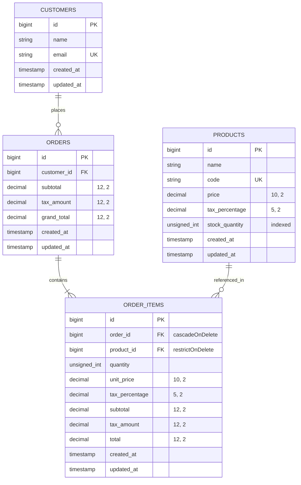

# Store Order & Inventory Management System

A robust, maintainable, and normalized retail counter application built with **Laravel 10**, **MySQL (InnoDB)**, and **Bootstrap 5**. Designed specifically for a retail counter / POS environment to manage products, customers, orders, and real-time inventory deductions with high-concurrency race protection.

---

## 1. Project Overview

The Store Order & Inventory System allows retail operators to:
- Browse and track real-time stock levels and automatically flag low-stock products.
- Create orders for new or existing customers using atomic database transactions.
- Prevent inventory overselling under high concurrency through pessimistic locking (`lockForUpdate`).
- Preserve historical financial integrity by locking unit prices and tax rates directly within order items.
- Dispatch asynchronous order confirmation notifications via Laravel's database-backed queue.
- Query customer historical orders with granular item breakdowns.
- Use a clean POS counter web interface built with Blade and Bootstrap 5.

---

## 2. Technology Requirements

- **PHP**: ^8.1
- **Laravel Framework**: ^10.0
- **Database**: MySQL 8.0+ (InnoDB storage engine required for row-level locking)
- **PHP Extensions**: `pdo_mysql`, `bcmath`, `json`, `mbstring`, `tokenizer`, `xml`, `ctype`
- **Dependency Manager**: Composer 2.x

---

## 3. Installation & Setup

### Step 1: Clone or Navigate to the Repository
```bash
cd d:/order_and_inventory_system
```

### Step 2: Install PHP Dependencies
```bash
composer install
```

### Step 3: Configure Environment Variables
Copy `.env.example` to `.env` (if not already done) and configure database credentials:
```bash
cp .env.example .env
php artisan key:generate
```

Verify your `.env` contains the required database settings:
```env
DB_CONNECTION=mysql
DB_HOST=127.0.0.1
DB_PORT=3306
DB_DATABASE=store_order_inventory
DB_USERNAME=root
DB_PASSWORD=

QUEUE_CONNECTION=database
```

### Step 4: Database Setup & Migrations
Ensure the MySQL database `store_order_inventory` exists:
```sql
CREATE DATABASE IF NOT EXISTS store_order_inventory;
CREATE DATABASE IF NOT EXISTS store_order_inventory_test;
```

Run the database migrations and seed realistic demo products and customers:
```bash
php artisan migrate:fresh --seed
```

---

## 4. Running the Application & Queue Worker

### Start the Local Development Server
```bash
php artisan serve
```
The application will be accessible at:
- **Web Interface (POS Counter & Dashboard)**: `http://127.0.0.1:8000`
- **API Base URL**: `http://127.0.0.1:8000/api`

### Start the Queue Worker
The application uses the `database` queue driver to process simulated customer email notifications asynchronously (`SendOrderConfirmationJob`):
```bash
php artisan queue:work
```
Job execution details (Order ID, Customer Email, and Total) are logged to `storage/logs/laravel.log`.

---

## 5. Running the Automated Test Suite

A complete suite of PHPUnit feature tests covers order creation, inventory deduction, rollback guarantees, validation constraints, and multi-process concurrency locks.

To execute all tests:
```bash
php artisan test
```

### Test Suite Highlights
- `OrderCreationTest`: Tests happy paths, calculation math, customer reuse, stock deduction, rollback on partial failures, and queue dispatch behavior.
- `OrderConcurrencyTest`: Genuine multi-process concurrency test that runs two simultaneous CLI worker processes competing for the very last unit of stock in MySQL. Verifies that exactly one process succeeds and one fails, with zero overselling.
- `CustomerOrderHistoryTest`: Validates customer retrieval, eager-loaded order relationships, and 404/422 handling.
- `LowStockProductsTest`: Tests threshold filtering (`stock_quantity < threshold`), default parameter behavior, and non-negative integer validation.
- `DashboardTest`: Verifies the Blade POS frontend view renders without errors.

---

## 6. Database Schema & Architecture

The database is normalized across four primary tables with appropriate foreign keys, cascading constraints, and indexes.



### Relationship Design & Eloquent Configuration
- `Customer` **hasMany** `Order`: A customer can place multiple orders. Customer records are matched and reused by `email`.
- `Order` **belongsTo** `Customer`: Foreign key `customer_id` references `customers.id`. Cascading delete removes customer orders if a customer is pruned.
- `Order` **hasMany** `OrderItem`: Foreign key `order_id` references `orders.id` with `cascadeOnDelete()`. Deleting an order cleans up its line items.
- `OrderItem` **belongsTo** `Order`: References the parent order.
- `OrderItem` **belongsTo** `Product`: Foreign key `product_id` references `products.id` with `restrictOnDelete()`. Products that have historical sales cannot be inadvertently dropped.
- `Product` **hasMany** `OrderItem`: A product can appear across multiple order items.

### Snapshotting Financial Attributes
Prices and tax percentages fluctuate over time. `order_items` stores historical snapshots of `unit_price`, `tax_percentage`, `subtotal`, `tax_amount`, and `total`. Any future modification of product prices in the catalog never alters past order receipts.

---

## 7. Order Calculation & Rounding Policy

### Formula Breakdown
For each item in the order:
1. `line_subtotal = unit_price * quantity`
2. `line_tax = line_subtotal * tax_percentage / 100`
3. `line_total = line_subtotal + line_tax`

For the overall order:
1. `order_subtotal = SUM(line_subtotals)`
2. `order_tax_amount = SUM(line_tax_amounts)`
3. `order_grand_total = order_subtotal + order_tax_amount`

### Decimal-Safe Precision Policy
- All monetary arithmetic is performed using PHP's **BCMath (`bcadd`, `bcmul`, `bcdiv`)** extension to eliminate IEEE 754 binary floating-point precision loss.
- Tax amounts per line item are rounded to 2 decimal places using standard **Half-Up Rounding** (`round($tax, 2, PHP_ROUND_HALF_UP)`), which aligns with banking and retail tax regulations.
- Grand totals are calculated strictly as `order_subtotal + order_tax_amount`, ensuring the sum of lines matches the header receipt without penny discrepancies.

---

## 8. High-Concurrency & Inventory Race Protection

Preventing overselling when multiple concurrent requests attempt to purchase limited stock is critical.

### Implementation Strategy
1. **Database Transaction (`DB::transaction`)**: All steps (customer resolution, locking, stock check, inventory deduction, order creation, item creation) execute inside an atomic InnoDB transaction.
2. **Deterministic Lock Ordering**: Product IDs requested in an order are sorted numerically in ascending order (`sort($productIds, SORT_NUMERIC)`) prior to acquiring locks. When two orders request products in opposing sequences (e.g. `[1, 2]` vs `[2, 1]`), deterministic lock ordering guarantees both transactions acquire row locks in identical sequence, completely avoiding database deadlocks.
3. **Pessimistic Row Locking (`lockForUpdate()`)**: Products are retrieved with `Product::whereIn('id', $productIds)->orderBy('id')->lockForUpdate()->get()`. InnoDB applies an exclusive row-level lock (`SELECT ... FOR UPDATE`).
4. **Synchronous Stock Verification & Atomic Decrement**: The transaction validates that every locked product has `stock_quantity >= requested_quantity`. If sufficient, `$product->decrement('stock_quantity', $quantity)` is executed.
5. **Atomic Rollback on Insufficient Stock**: If even one product has inadequate stock, an `InsufficientStockException` is thrown. The transaction immediately rolls back completely; zero stock is deducted and zero orders are created.
6. **After-Commit Job Dispatching**: The queued notification (`SendOrderConfirmationJob::dispatch($order)`) is dispatched only after the transaction has successfully committed to the database. Failed or aborted transactions never emit confirmation jobs.

---

## 9. API Reference & Usage

### 1. Create Order
Creates a new order, resolves customer by email, validates inventory with pessimistic locking, and decrements stock.

- **Method**: `POST`
- **Endpoint**: `/api/orders`
- **Headers**: `Content-Type: application/json`, `Accept: application/json`

#### Example Request
```json
{
  "customer": {
    "name": "Rohit Patil",
    "email": "rohit@example.com"
  },
  "items": [
    {
      "product_id": 1,
      "quantity": 2
    },
    {
      "product_id": 4,
      "quantity": 1
    }
  ]
}
```

#### Successful Response (HTTP 201 Created)
```json
{
  "success": true,
  "message": "Order created successfully",
  "data": {
    "id": 1,
    "customer_id": 1,
    "subtotal": "1648.00",
    "tax_amount": "269.64",
    "grand_total": "1917.64",
    "created_at": "2026-10-29T14:00:00.000000Z",
    "updated_at": "2026-10-29T14:00:00.000000Z",
    "customer": {
      "id": 1,
      "name": "Rohit Patil",
      "email": "rohit@example.com"
    },
    "order_items": [
      {
        "id": 1,
        "order_id": 1,
        "product_id": 1,
        "quantity": 2,
        "unit_price": "599.00",
        "tax_percentage": "18.00",
        "subtotal": "1198.00",
        "tax_amount": "215.64",
        "total": "1413.64",
        "product": {
          "id": 1,
          "name": "Wireless Optical Mouse",
          "code": "PRD-MOU-001"
        }
      },
      {
        "id": 2,
        "order_id": 1,
        "product_id": 4,
        "quantity": 1,
        "unit_price": "450.00",
        "tax_percentage": "12.00",
        "subtotal": "450.00",
        "tax_amount": "54.00",
        "total": "504.00",
        "product": {
          "id": 4,
          "name": "Stainless Steel Water Bottle (750ml)",
          "code": "PRD-BOT-004"
        }
      }
    ]
  }
}
```

#### Insufficient Stock Error Response (HTTP 422 Unprocessable Entity)
```json
{
  "success": false,
  "message": "Insufficient stock for product: Ergonomic Aluminum Laptop Stand. Requested: 5, Available: 2",
  "errors": {
    "stock": [
      "Insufficient stock for product: Ergonomic Aluminum Laptop Stand. Requested: 5, Available: 2"
    ]
  }
}
```

#### Validation Error Response (HTTP 422 Unprocessable Entity)
```json
{
  "success": false,
  "message": "The given data was invalid.",
  "errors": {
    "customer.email": [
      "The customer.email field must be a valid email address."
    ],
    "items": [
      "The items field must have at least 1 items."
    ]
  }
}
```

---

### 2. Customer Order History
Retrieves all historical orders for a customer with order items and product metadata.

- **Method**: `GET`
- **Endpoint**: `/api/customers/orders?email=rohit@example.com`
- **Headers**: `Accept: application/json`

#### Successful Response (HTTP 200 OK)
```json
{
  "success": true,
  "message": "Customer orders retrieved successfully",
  "data": {
    "customer": {
      "id": 1,
      "name": "Rohit Patil",
      "email": "rohit@example.com"
    },
    "orders": [
      {
        "id": 1,
        "customer_id": 1,
        "subtotal": "1648.00",
        "tax_amount": "269.64",
        "grand_total": "1917.64",
        "created_at": "2026-10-29T14:00:00.000000Z",
        "order_items": [
          {
            "id": 1,
            "order_id": 1,
            "product_id": 1,
            "quantity": 2,
            "unit_price": "599.00",
            "tax_percentage": "18.00",
            "subtotal": "1198.00",
            "tax_amount": "215.64",
            "total": "1413.64",
            "product": {
              "id": 1,
              "name": "Wireless Optical Mouse",
              "code": "PRD-MOU-001"
            }
          }
        ]
      }
    ]
  }
}
```

#### Customer Not Found (HTTP 404 Not Found)
```json
{
  "success": false,
  "message": "Customer not found",
  "errors": {
    "email": [
      "No customer found with the provided email address."
    ]
  }
}
```

---

### 3. Low-Stock Products
Returns products whose current stock level is strictly less than the specified threshold.

- **Method**: `GET`
- **Endpoint**: `/api/products/low-stock?threshold=5`
- **Parameters**: `threshold` (optional, non-negative integer, default: `5`)
- **Headers**: `Accept: application/json`

#### Successful Response (HTTP 200 OK)
```json
{
  "success": true,
  "message": "Low-stock products retrieved successfully",
  "data": [
    {
      "id": 10,
      "name": "Ceramic Coffee Mug (350ml)",
      "code": "PRD-MUG-010",
      "price": "220.00",
      "tax_percentage": "12.00",
      "stock_quantity": 1
    },
    {
      "id": 6,
      "name": "Ergonomic Aluminum Laptop Stand",
      "code": "PRD-STA-006",
      "price": "1299.00",
      "tax_percentage": "18.00",
      "stock_quantity": 2
    },
    {
      "id": 4,
      "name": "Stainless Steel Water Bottle (750ml)",
      "code": "PRD-BOT-004",
      "price": "450.00",
      "tax_percentage": "12.00",
      "stock_quantity": 3
    },
    {
      "id": 8,
      "name": "Portable Bluetooth Speaker (5W)",
      "code": "PRD-SPK-008",
      "price": "1499.00",
      "tax_percentage": "18.00",
      "stock_quantity": 4
    }
  ]
}
```

---

### 4. Create Product (Catalog & Inventory)
Creates a new product with its SKU code, price, tax percentage, and initial store stock quantity.

- **Method**: `POST`
- **Endpoint**: `/api/products`
- **Headers**: `Content-Type: application/json`, `Accept: application/json`

#### Example Request
```json
{
  "name": "Wireless Ergonomic Mouse",
  "code": "PRD-WEM-011",
  "price": 799.00,
  "tax_percentage": 18.00,
  "stock_quantity": 30
}
```

#### Successful Response (HTTP 201 Created)
```json
{
  "success": true,
  "message": "Product created successfully",
  "data": {
    "id": 11,
    "name": "Wireless Ergonomic Mouse",
    "code": "PRD-WEM-011",
    "price": "799.00",
    "tax_percentage": "18.00",
    "stock_quantity": 30,
    "created_at": "2026-10-30T11:45:00.000000Z",
    "updated_at": "2026-10-30T11:45:00.000000Z"
  }
}
```

---

### 5. Maintain Stock Quantity (Restock / Adjust)
Updates the available stock level for an existing product (e.g. upon receiving new shipment).

- **Method**: `PATCH`
- **Endpoint**: `/api/products/{id}/stock`
- **Headers**: `Content-Type: application/json`, `Accept: application/json`

#### Example Request
```json
{
  "stock_quantity": 50
}
```

#### Successful Response (HTTP 200 OK)
```json
{
  "success": true,
  "message": "Stock quantity updated successfully",
  "data": {
    "id": 1,
    "name": "Wireless Optical Mouse",
    "code": "PRD-MOU-001",
    "price": "599.00",
    "tax_percentage": "18.00",
    "stock_quantity": 50
  }
}
```

---

### 6. Product Catalog Listing
Returns all products ordered alphabetically by name for POS selection.

- **Method**: `GET`
- **Endpoint**: `/api/products`
- **Headers**: `Accept: application/json`

---

## 10. Key Assumptions & Design Decisions

1. **Customer Records Reused by Email**: Customers are identified uniquely by email. If the email already exists in the system, that customer is reused for the order. Concurrent customer creation is handled safely with unique database indexes and catch-and-find fallback logic.
2. **Product Price & Tax Snapshotting**: Product prices and tax percentages are captured at the moment of order placement and saved into `order_items`. Subsequent edits to catalog prices do not alter historical orders.
3. **Low-Stock Comparison Operator**: Low stock is strictly evaluated as `stock_quantity < threshold`. A product with exactly 5 units is not considered low stock under the default threshold of 5.
4. **Atomic Inventory & Rollback**: An order cannot be partially created. If any single product in an order has insufficient stock, the entire transaction rolls back immediately and no inventory changes occur.
5. **Duplicate Product IDs in a Single Request**: If a request payload contains duplicate entries for the same `product_id` (e.g. scanned twice at the POS), `OrderService` consolidates the quantities into a single unified line item before stock evaluation and deduction.
6. **Queued Email Simulation**: Real external SMTP is bypassed. Order confirmation emails are simulated via `SendOrderConfirmationJob` using Laravel's queue worker, which writes execution details to the application log.
7. **Currency Representation**: For demonstration purposes, monetary values are denoted in Indian Rupees (INR, ₹). All database columns use standard SQL `decimal` representations (`(10,2)` for unit prices and `(12,2)` for order totals).
8. **Comment-Free Source Code**: In compliance with the coding rules, all PHP source code, controllers, models, migrations, seeders, requests, jobs, and tests are completely free of inline comments, docblocks, and placeholders.

---

## 11. Known Limitations

- **Authentication**: As a take-home interview assignment focused on core business logic, API authentication (e.g. Laravel Sanctum / Passport) is omitted to simplify local testing.
- **Single Currency**: The current version assumes single-currency operations (INR). Multi-currency conversion requires a dedicated exchange rate service.
